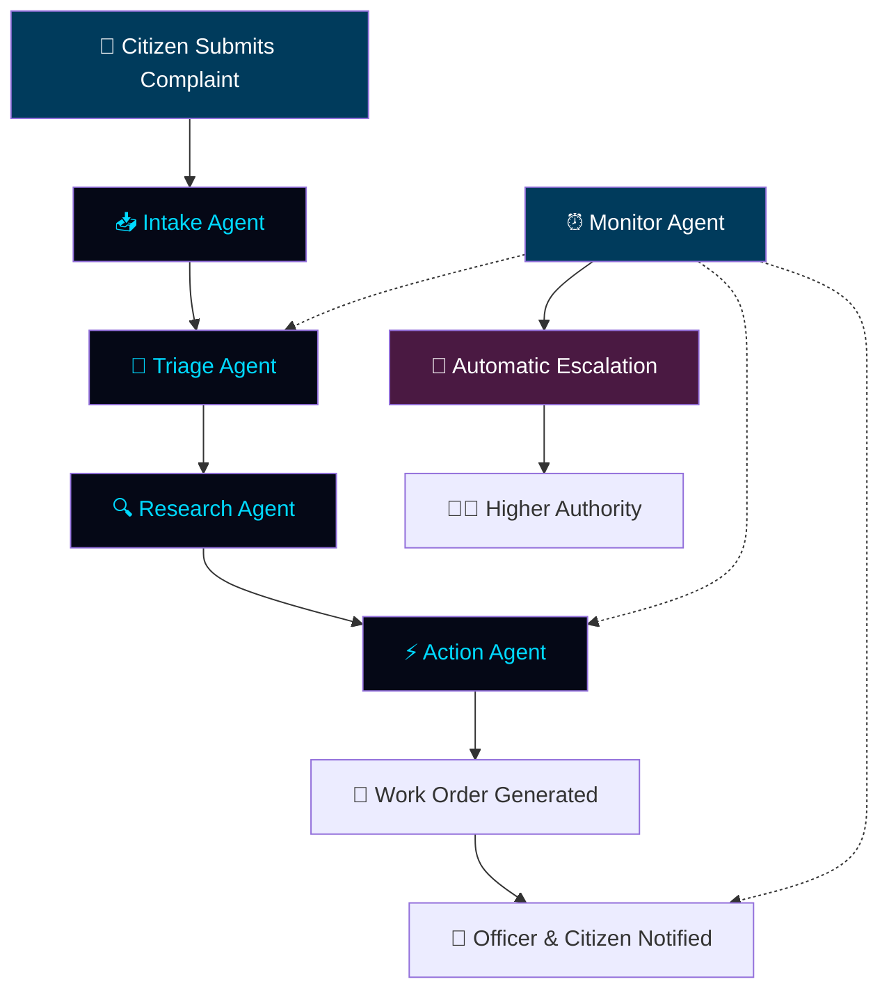

<div align="center">


<br/>


<br/><br/>

**Empowering villages through intelligent complaint management.**

</div>

---

## 🌍 About The Project

**GramSahayak** is an autonomous multi-agent AI system designed to transform how Gram Panchayats receive, manage, track, and resolve citizen complaints.

It focuses on two essential rural infrastructure issues:

- 💧 Water supply problems
- 🧹 Sanitation and cleanliness issues

Instead of relying on slow manual processes, GramSahayak uses specialized AI agents to process complaints, identify urgency, assign responsible officers, generate action documents, and monitor deadlines.

### 🎯 Our Mission

To make rural grievance management smarter, faster, more transparent, and accountable.

---

## 🚨 The Problem

In many villages, citizen complaints face several challenges:

- Complaints are recorded manually or informally.
- Urgent issues may not receive immediate attention.
- Duplicate complaints create unnecessary workload.
- Citizens have limited visibility into complaint status.
- Delayed actions often go unnoticed.
- There is no consistent automated escalation mechanism.

## 💡 Our Solution

GramSahayak introduces an intelligent multi-agent workflow that manages the complaint lifecycle from submission to escalation.

<details>
<summary><b>✨ Key Features</b></summary>

- 🤖 Autonomous multi-agent complaint processing
- 🧠 AI-powered complaint classification and prioritization
- 🔍 Duplicate complaint detection
- 📍 Location and urgency extraction
- 📚 Context and relevant-rule research
- 📄 Automated work-order drafting
- 📢 Officer and citizen notifications
- ⏰ Deadline monitoring and escalation
- 📊 Complaint management dashboard

</details>

---

## ⚙️ How It Works

<div align="center">



</div>

### 🤖 Meet the Five AI Agents

| Agent | Responsibility |
|:---|:---|
| 📥 Intake Agent | Extracts complaint category, location, and urgency |
| 🧠 Triage Agent | Detects duplicates, assigns priority, and selects an officer |
| 🔍 Research Agent | Finds relevant rules, contextual information, and similar cases |
| ⚡ Action Agent | Drafts work orders and prepares officer/citizen notifications |
| ⏰ Monitor Agent | Tracks deadlines and automatically escalates overdue cases |

---

## 🛠️ Technology Stack

<div align="center">

| Technology | Purpose |
|:---:|:---|
|  | Core programming |
|  | Backend API |
|  | Database |
|  | AI agent intelligence |
|  | Frontend |
|  | Frontend interactions |

</div>

---

## 📂 Project Structure

```text
GramSahayak/
│
├── app/
│   ├── main.py
│   ├── agents/
│   │   ├── intake.py
│   │   ├── triage.py
│   │   ├── research.py
│   │   ├── action.py
│   │   └── monitor.py
│   │
│   ├── routes/
│   ├── services/
│   └── database/
│
├── frontend/
│   ├── index.html
│   ├── style.css
│   └── script.js
│
├── requirements.txt
├── .env.example
├── .gitignore
└── README.md
```

*Adjust this structure to match your actual repository.*

---

## 🚀 Getting Started

### Prerequisites

- Python 3.11
- pip
- Anthropic API key

### Installation

**1. Clone the repository**

```bash
git clone <repo-url>
cd <team-name>
```

**2. Create a virtual environment**

```bash
python -m venv venv
```

**3. Activate the environment**

Windows:
```bash
venv\Scripts\activate
```

Linux / macOS:
```bash
source venv/bin/activate
```

**4. Install dependencies**

```bash
pip install -r requirements.txt
```

**5. Configure environment variables**

```bash
cp .env.example .env
```

Add your API key to `.env`:

```env
ANTHROPIC_API_KEY=your_api_key_here
```

Never commit your actual `.env` file or API key.

**6. Run the application**

```bash
uvicorn app.main:app --reload
```

**7. Open the dashboard**

```text
http://localhost:8000
```

Click **Load Sample Complaint** to explore the demonstration workflow.

---

## 🎬 Demo Workflow

<div align="center">

| Step | Demonstration |
|:---:|:---|
| 01 | Submit a sample water supply complaint |
| 02 | Intake Agent extracts complaint details |
| 03 | Triage Agent evaluates urgency and duplicates |
| 04 | Research Agent gathers relevant context |
| 05 | Action Agent drafts a work order |
| 06 | Monitor Agent tracks deadlines and escalation |

</div>

---

## 🌱 Social Impact

GramSahayak aims to contribute towards:

- 💧 Improved water supply complaint handling
- 🏡 Cleaner and healthier village environments
- ⚖️ Better administrative accountability
- 📊 Transparent complaint tracking
- 🤝 Stronger communication between citizens and local authorities

---

## 🔮 Future Enhancements

- 🌐 Multilingual complaint submission
- 📱 WhatsApp-based complaint registration
- 🗺️ Geographic complaint visualization
- 📷 Image-based issue identification
- 📈 Advanced analytics and reporting
- 🔔 SMS and real-time notifications
- 🏛️ Integration with official Panchayat systems

---

## 👥 Our Team

<div align="center">

**Built with 💙 for smarter and more accountable villages.**

| Team Member | Role |
|:---:|:---|
| <names> | AI / ML Engineering & Development |

</div>

---

<div align="center">

### 💙 GramSahayak

**Smart Villages. Faster Responses. Better Communities.**

*Technology with a purpose. Innovation with impact.*


</div>
